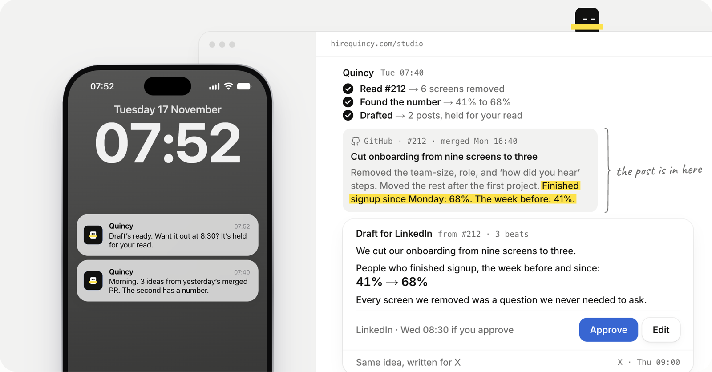
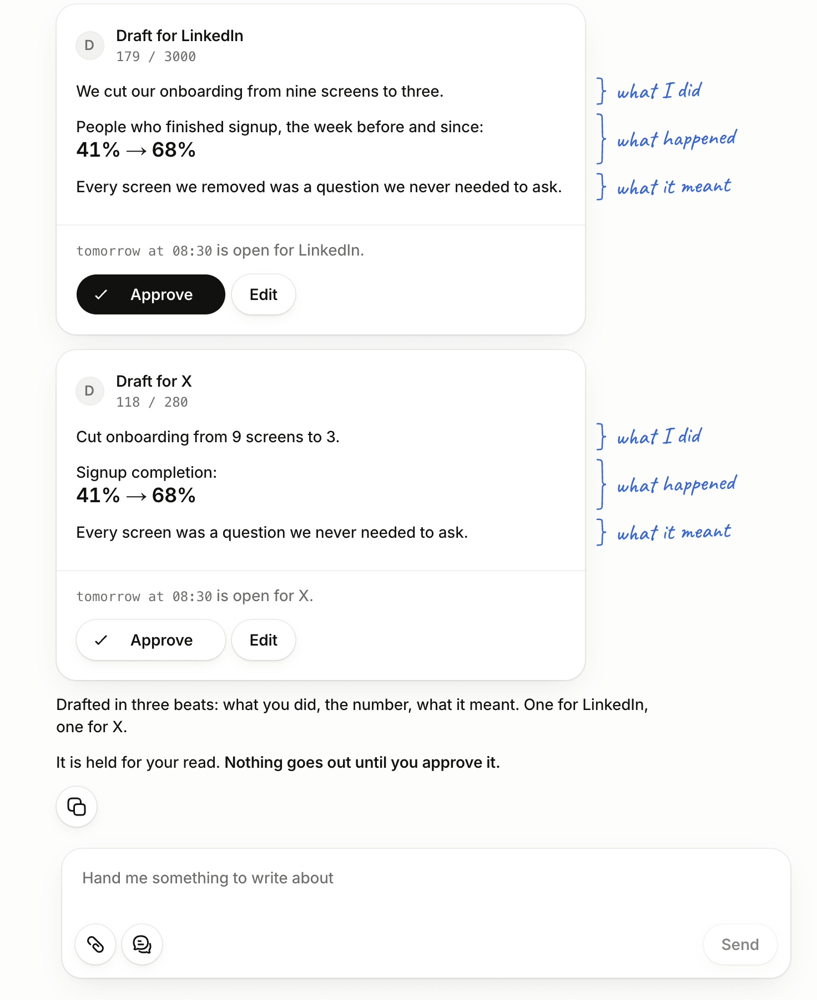
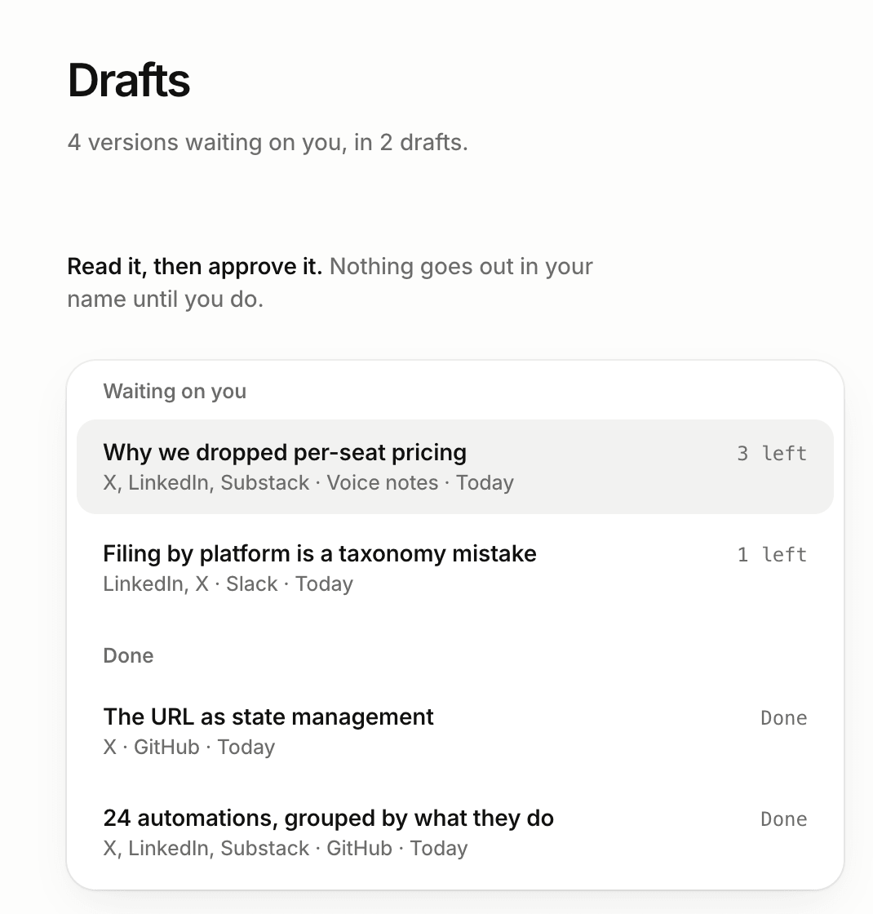

<p align="center">
  <picture>
    <source media="(prefers-color-scheme: dark)" srcset=".github/assets/quincy-dark.svg">
    
  </picture>
</p>

<h1 align="center">Quincy</h1>

<p align="center">It finds the post. It brings it to you.</p>

<p align="center">
  <a href="https://github.com/Codehagen/Quincy/stargazers"></a>
  <a href="LICENSE"></a>
  <a href="https://vercel.com/new/clone?repository-url=https%3A%2F%2Fgithub.com%2FCodehagen%2FQuincy&env=DATABASE_URL,BETTER_AUTH_SECRET,BETTER_AUTH_URL,AI_GATEWAY_API_KEY,CRON_SECRET&envDescription=A%20Neon%20connection%20string%2C%20an%20auth%20secret%2C%20your%20production%20URL%2C%20an%20AI%20Gateway%20key%20and%20a%20secret%20for%20the%20cron%20routes.&envLink=https%3A%2F%2Fgithub.com%2FCodehagen%2FQuincy%2Fblob%2Fmain%2Fdocs%2Fself-hosting.md&project-name=quincy&repository-name=quincy"></a>
</p>

<p align="center">
  <a href="https://hirequincy.com">Website</a> ·
  <a href="docs/self-hosting.md">Self-hosting</a> ·
  <a href="docs/vision.md">Vision</a> ·
  <a href="CONTRIBUTING.md">Contributing</a>
</p>

<p align="center">
  <a href="https://hirequincy.com"></a>
</p>

Quincy is an AI agent that does the job of a Head of Content. You do the work:
merge a pull request, record a voice note, finish a call. Quincy reads it, and
when there is a post in it, drafts one in your voice for each channel. Then it
waits. Nothing goes out under your name until you press Approve.

## Features

- **Studio.** A chat with Quincy. Every other page is the same state from
  another angle.
- **Sources.** Voice notes, GitHub pull requests as they merge, Circleback call
  notes, and text you paste. Sources that do not work yet are marked "next".
- **Ideas.** Two or three per piece of material, each named by where it came
  from.
- **Drafts.** Three beats: what you did, what happened, what it meant. The
  number sits on its own line and traces back to its source.
- **Channels.** Publishes to X and LinkedIn, with a rewrite per channel. Other
  channels can go through an external scheduler you run.
- **Lineup.** When each approved post goes out.
- **Numbers.** Each post against your own median. No follower counts.
- **Brain.** What Quincy knows about you and your voice, as pages you can read
  and edit.
- **Rhythm.** Scheduled jobs, like a weekly post from the week's small merges.
  They draft. You still send.
- **MCP.** Another agent can read your ideas, drafts, lineup and numbers, and
  add material. It cannot approve, schedule or publish. See
  [`docs/mcp.md`](docs/mcp.md).

### Studio

You hand Quincy the material and it comes back with a draft per channel, each
beat marked in the margin, held until you approve it.



### Drafts

Every piece that is waiting on you, with how many channel versions are left to
read.



## Quick start

<a href="https://vercel.com/new/clone?repository-url=https%3A%2F%2Fgithub.com%2FCodehagen%2FQuincy&env=DATABASE_URL,BETTER_AUTH_SECRET,BETTER_AUTH_URL,AI_GATEWAY_API_KEY,CRON_SECRET&envDescription=A%20Neon%20connection%20string%2C%20an%20auth%20secret%2C%20your%20production%20URL%2C%20an%20AI%20Gateway%20key%20and%20a%20secret%20for%20the%20cron%20routes.&envLink=https%3A%2F%2Fgithub.com%2FCodehagen%2FQuincy%2Fblob%2Fmain%2Fdocs%2Fself-hosting.md&project-name=quincy&repository-name=quincy"></a>

The button asks for five variables. Push the schema to the database first
(`pnpm db:push` from a clone, below), or the first sign-in has no tables to
write to.

To run it locally you need Node.js 22+, pnpm and a [Neon](https://neon.tech)
Postgres database. Use pnpm, not npm: `ffmpeg-static` installs without its
binary under npm. Neon is required, not just recommended: `lib/db.ts` uses
Neon's HTTP driver, so a plain Postgres URL will not connect. A free Neon
project is enough.

```bash
git clone https://github.com/Codehagen/Quincy.git
cd Quincy
pnpm install
cp .env.example .env.local
# fill in the variables below, then:
pnpm db:push
npx tsx --env-file=.env.local scripts/dev-account.ts
pnpm dev
```

| Variable | Value |
| --- | --- |
| `DATABASE_URL` | Your Neon connection string (pooled) |
| `BETTER_AUTH_SECRET` | `openssl rand -base64 32` |
| `BETTER_AUTH_URL` | `http://localhost:3000` locally, your domain in production |
| `AI_GATEWAY_API_KEY` | Needed for chat and drafting. Without it the app boots, and every model call fails |
| `CRON_SECRET` | `openssl rand -base64 32`. The cron routes refuse to run without it, so nothing scheduled is published |
| `DEV_ACCOUNT_EMAIL`, `DEV_ACCOUNT_PASSWORD` | A `@quincy.test` address and a password, for the local account |

Sign-up needs a verified email, so `dev-account.ts` creates a verified account
to sign in with at `http://localhost:3000`. It refuses any address outside
`@quincy.test`.

> [!WARNING]
> Point `DATABASE_URL` at a database you own. `pnpm db:push` and the
> `scripts/verify-*.ts` checks write to whatever it names.

Everything else in [`.env.example`](.env.example) is optional and says what it
does. A missing key turns its feature off instead of crashing the app.

## Self-hosting

Quincy runs anywhere Next.js runs. [`docs/self-hosting.md`](docs/self-hosting.md)
covers the optional integrations (Resend, the GitHub App, X and LinkedIn,
Stripe), migrations for a database that already has data, and the cron routes.

**Scheduled publishing and rhythms need a cron that runs often.**
[`vercel.json`](vercel.json) calls `/api/cron/publish` every 5 minutes and
`/api/cron/rhythms` every 15. Vercel's Hobby plan only runs crons once a day,
so on Vercel this needs the Pro plan. On Hobby, or off Vercel, point an
external scheduler at the cron routes with an
`Authorization: Bearer $CRON_SECRET` header.

**Video editing uses [Remotion](https://remotion.dev), which has its own
license.** It is free for individuals and small teams; a company above a
certain size needs a Remotion company license. Read
[remotion.dev/license](https://remotion.dev/license) before you host Quincy
for a business.

## Stack

- [Next.js 16](https://nextjs.org) (App Router, React Server Components)
- [AI SDK](https://ai-sdk.dev) through the Vercel AI Gateway
- [Better Auth](https://better-auth.com)
- [Drizzle](https://orm.drizzle.team) on [Neon](https://neon.tech) Postgres
- [Tailwind CSS v4](https://tailwindcss.com)
- [shadcn/ui](https://ui.shadcn.com) on [Base UI](https://base-ui.com): the
  components start from shadcn, and the chat in Studio follows shadcn's
  chatbot template
- [ui-sdk](https://ui-sdk.dev) for the behaviours Base UI does not cover
- [Hugeicons](https://hugeicons.com)
- [Resend](https://resend.com) for mail, [Stripe](https://stripe.com) for billing

## Contributing

Read [`docs/vision.md`](docs/vision.md) before you build a feature. It lists
what Quincy will not do, and a clean pull request for one of those will still
be closed. [`CONTRIBUTING.md`](CONTRIBUTING.md) covers setup, quality gates and
review. Coding agents start with [`AGENTS.md`](AGENTS.md).

Report security issues privately, as [`SECURITY.md`](SECURITY.md) describes, or
by email to security@hirequincy.com. Please do not open a public issue.

## License

[AGPL-3.0](LICENSE). You can run, change and host Quincy. If you run a modified
version as a service for other people, you have to offer them its source code.
